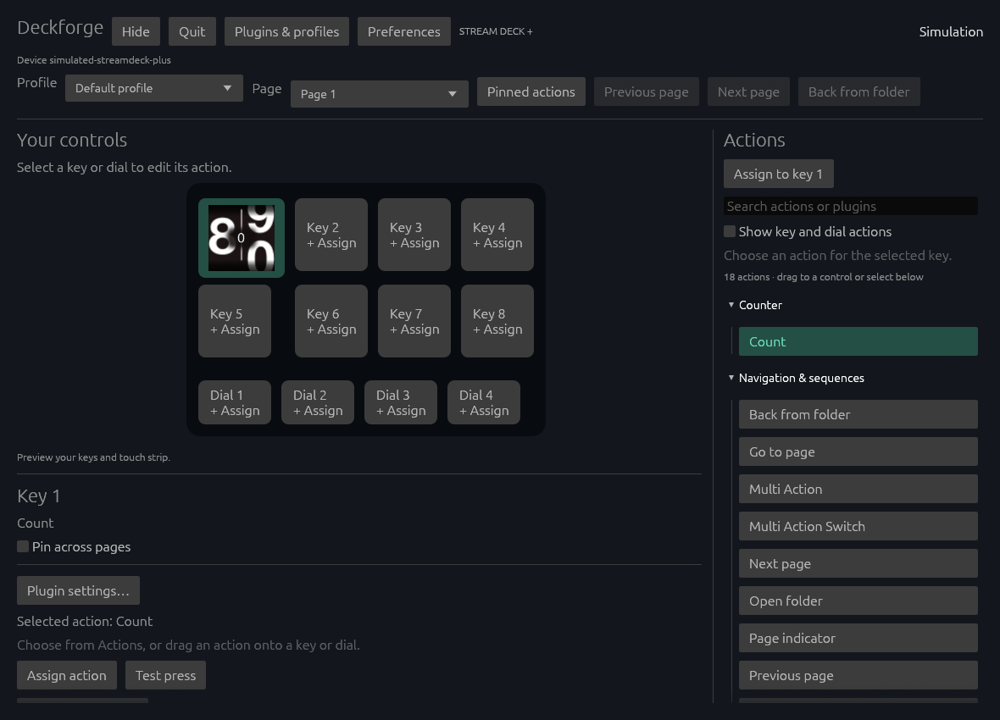

# Deckforge

A native Linux desktop app for Stream Deck+, written from scratch in Rust.

**Made with AI.** Elgato wasn't making a Linux port of the Stream Deck app, and I didn't want an expensive paperweight on my table. This project is the result.

Deckforge is independent of Elgato. It uses official documentation, sample plugins and shipped artifacts as references, with REA supporting the reverse-engineering work. It does not use an existing Linux Stream Deck application or driver implementation as its starting point.

## Status

Work in progress. **This is not feature complete yet.** Existing Elgato profiles and plugins are compatibility targets, but Windows-only plugin executables and some desktop features still do not work.

Current working areas include:

- An always-dark native Rust editor with searchable actions, drag assignment, tray/background operation, offline editing, and Stream Deck+ controls.
- Profiles, pages, folders, pinned actions, and original-format profile import/export.
- Node and HTML plugins, native property inspectors, portable plugin resources, and feedback layouts.
- Multi Actions, Dial Stacks, Action Triggers, Linux desktop actions, and a native soundboard.
- Live system-volume feedback and configurable volume steps.

See the [feature-parity ledger](streamdeck-linux/docs/FEATURE_PARITY.md) for the remaining work and the boundaries of the tests. Passing simulation tests is not a claim of complete hardware or Windows compatibility.



The native editor above is running in simulation with Elgato's official Counter sample.

## Build and run

The application source is in [`streamdeck-linux/`](streamdeck-linux/).

```sh
git clone https://github.com/JackSkellet/deckforge.git
cd deckforge/streamdeck-linux
cargo build --release --locked
python scripts/install-desktop.py
~/.local/bin/deckforge
```

A current Rust toolchain and native development libraries are required, including GTK3, WebKitGTK 4.1, libudev and libpulse. Development currently takes place on CachyOS/Arch. The installer is per-user; it does not install system packages or change device permissions.

For a preview without opening USB hardware:

```sh
cargo run --release -- desktop --simulate
```

Simulation disables USB access. Configured actions and plugins can still perform their normal desktop/network operations.

See the [application README](streamdeck-linux/README.md) for features, commands, dependencies and validation. Some integration tests require separately obtained official samples or reference artifacts. Installers, local profiles, test captures and build outputs are excluded from this repository.

## License

[MIT](LICENSE). Third-party libraries and external plugin/reference fixtures retain their own licenses.
