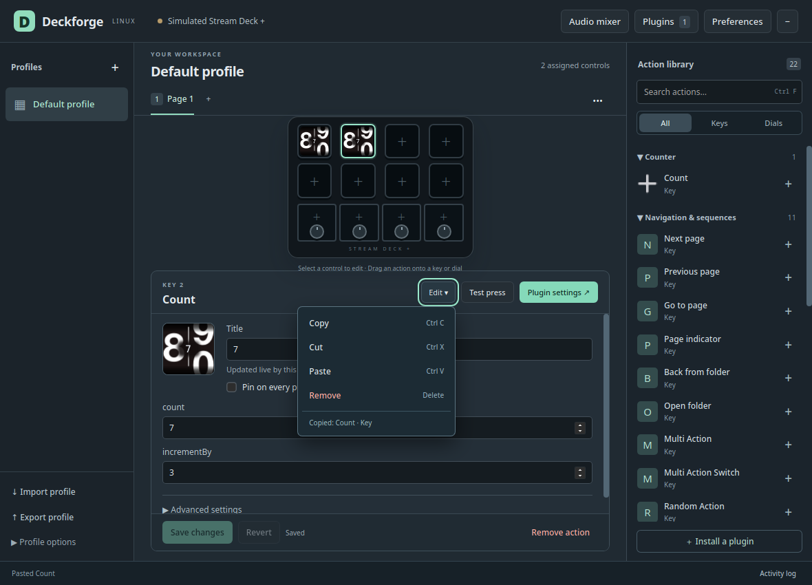

# Move and copy actions

Right-click a key or dial, or use its **Edit** menu. The same menu opens with
Shift+F10 or the keyboard Menu key. Keyboard shortcuts operate on the selected
control when focus is outside text fields and dialogs.

| Operation | Result |
| --- | --- |
| Copy / Ctrl+C | Capture the saved action in Deckforge's action clipboard. |
| Cut / Ctrl+X | Mark the source for moving. It remains in place until paste succeeds. |
| Paste / Ctrl+V | Copy into the selected control, or complete a cut. |
| Drag a control | Move it; an occupied destination swaps with the source. |
| Ctrl-drag a control | Copy it, replacing the destination. |
| Remove / Delete | Remove the selected action. |
| Cancel cut / Escape | Clear the pending cut without changing its source. |

Save or revert unsaved action edits before transferring that action. The editor
also protects a destination with an unsaved draft. The Rust host rejects stale
destinations and incompatible key/dial assignments. A move that swaps two controls
checks compatibility in both directions. Read-only profiles allow copying out.

The clipboard survives closing and reopening the editor within the same process.
It clears when Deckforge quits. Text fields retain their normal text clipboard.
System clipboard interoperability and `.streamDeckAction` sharing are unfinished.

## Profiles and folders

Copy or cut an action, select another page or profile, then paste. Nested Multi
Actions, Dial Stacks and Action Triggers travel with their parent control.
Copied folders receive independent page trees. Imported state images, animation
bytes, resource bindings and unknown settings remain attached to their original
managed archive until export embeds them in the destination profile.

Moving a pinned action into an empty regular-page control unpins it. Swapping
with a pinned control exchanges the actual occupants of those positions. Copying
into an occupied control replaces it; general undo remains unfinished.

Moves create fresh runtime contexts so plugins receive a release and disappearance
for the old placement, followed by appearance at the new coordinates. Delayed
messages for retired contexts cannot change the newly placed action. When a folder
moves across profiles, unused source pages are retained conservatively, as with
existing folder deletion.

## Evidence

Elgato documents right-click editing in its [Quick Start Guide](https://www.elgato.com/us/en/explorer/products/stream-deck/elgato-stream-deck-quick-start-guide/).
Deckforge's implementation is tested through the real Rust host with the unchanged
official Counter sample, an inert lifecycle probe, independent folder copies,
multi-state SVG export and restart. Native WebKit tests exercise React Copy/Paste.
These checks do not establish complete Windows editor parity or physical input
acceptance of every editing workflow.
