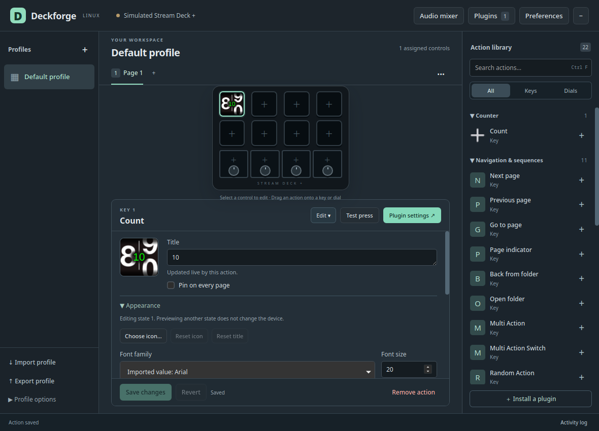

# Action appearance

Select a key or dial and expand **Appearance**. Choose a custom icon or change
the title's font, size, style, underline, colour, alignment and visibility. The
preview uses the same Rust renderer as the device. **Save changes** applies the
draft; previewing alone does not update the hardware or saved profile.

Multi-state actions have an **Appearance state** selector. Editing another state
does not switch the active key. If the plugin changes its live state during an
edit, refresh the state and preview before saving. Drafts remain attached to their
original target state.

The app preserves the plugin's live settings while saving appearance changes.
Changing an action setting alone does not create a custom title. Actions that
reserve their title for the plugin keep the text field disabled while allowing
font and icon customization.

## Custom appearance and plugin updates

Custom user titles and icons take priority over SDK updates, following Elgato's
[key-action contract](https://docs.elgato.com/streamdeck/sdk/guides/keys/).
Plugin updates remain stored underneath. **Reset title** and **Reset icon** restore
the available underlying appearance. Imported profile title/image fields are
treated as user overrides; resetting those falls back to the installed plugin's
manifest. A newly chosen icon over an imported icon first resets to that imported
baseline.

Deckforge sends `titleParametersDidChange` using the official
[title-parameter fields](https://docs.elgato.com/streamdeck/sdk/references/websocket/plugin/#titleparametersdidchange).
Sparse style changes preserve untouched fields and unknown profile metadata.
Copied actions and nested actions retain their appearance independently.

## Fonts and images

Font families come from Fontconfig. The editor reports when a requested font is
substituted. Font discovery and parsing are cached and do not hold the shared
render cache lock while accessing files or running Fontconfig.

Original custom image bytes are stored in the session's managed asset directory
and embedded into exported profiles. SVG/GIF/JPEG originals are preserved rather
than replaced with screenshots. Decoded caches are bounded separately so a large
photo cannot make the saved session unreadable.

User overrides and original profile assets are exported. New transient SDK title
and image caches stay in Deckforge session storage; exporting them as user
overrides would incorrectly block future plugin updates after import. Older
profiles cannot always distinguish a previously exported runtime frame from an
intentional custom icon, so Reset remains the explicit way to remove an imported
override.

## Current boundaries

- Key font sizing uses a documented Linux policy, not verified Windows pixel
  metrics. Complex text shaping, per-character font fallback and exact Windows
  visual equivalence remain open.
- Saved GIF artwork now animates with bounded decoding and preserved original
  bytes. Deckforge also supports animated SDK `setImage` as a requested extension.
  See [animated images](ANIMATED_IMAGES.md) for timing, target ownership and limits.
- Key SDK target 0 updates both displays, target 1 only hardware, and target 2
  only the editor. State-specific updates and independent resets are supported.
  Dial SDK images update the circular editor icon; feedback controls the LCD.
  See [display target contracts and tests](PLUGIN_DISPLAY_TARGETS.md).
- Composite Action Trigger and Dial Stack displays render their child actions;
  parent artwork does not replace those composite layouts.

Short process/native UI tests verify rendered colours and alignment, SDK event
payloads, override/reset precedence, inactive-state isolation, read-only previews,
live Counter updates during editing, byte-preserving export and restart. Physical
appearance acceptance remains with the connected device/user workflow.
