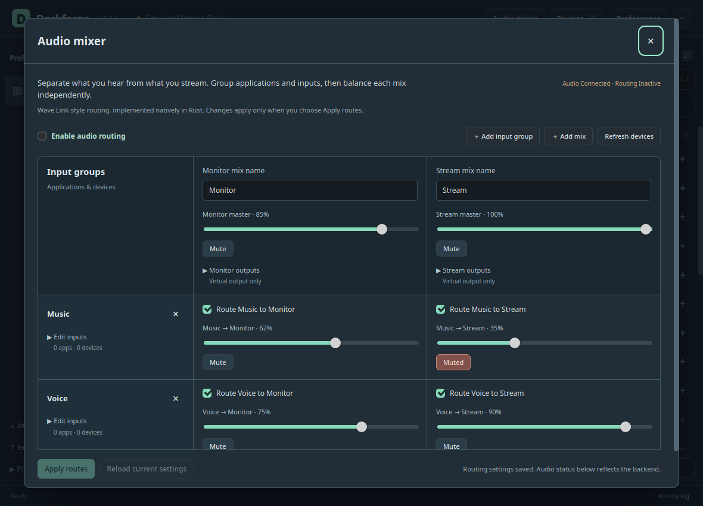

# Audio mixer

Deckforge's mixer is an original Rust implementation using the PulseAudio protocol,
including PipeWire's PulseAudio server. It provides independent monitor and stream
mixes inside the desktop application. It does not run Wave Link or Wine.

## Configure routing

1. Open **Audio mixer** in the editor header. This reads the available devices and
   playing applications; it does not enable routing.
2. Add an input group. Expand **Edit inputs** to choose applications or exact input
   devices. App IDs and process names match future streams from that application.
3. Enable a route from each input group to the desired mixes. Set its level and
   mute independently. Expand a mix's outputs to select physical destinations.
4. Enable audio routing and choose **Apply routes**. Changes remain drafts until
   applied. A draft made stale by another control must be reloaded before saving.
5. Select a mix's **Deckforge mix** virtual input in the application that should
   record or broadcast it. The mixer does not change system default devices.

Monitor and Stream are the initial mix names. You can add up to five mixes and
twelve input groups. A group can contain several applications and input devices;
a mix can feed several outputs. Missing saved devices remain visible and are not
silently replaced with the system default. The implementation currently uses
48 kHz stereo audio and linear-amplitude volume percentages.

## Keys and dials

The action library contains **Mixer channel** and **Mixer output mix**. Choose a
configured input group and mix for the channel action, or a mix for its master
control. Dial rotation adjusts the configured percentage step; push or touch
toggles mute. Keys can toggle mute, set a level, or change it by a fixed amount.
These actions also work inside supported Multi Actions and Dial Stacks.

Device actions never enable the mixer or create routes. Their displays show the
last level accepted by the mixer worker, with pending and unavailable states.
This is control feedback, not an audio level meter. The action IDs and settings
are original Deckforge definitions, not guessed Elgato settings.

## Lifetime and recovery

Closing the editor leaves routing active. Disabling the mixer or quitting restores
explicitly moved applications when their original output still exists. A stream
the user moved elsewhere is left there. If its original output is missing, the
owned channel remains silent until it can be restored. An external recorder still
attached to a mix likewise retains a silent virtual input rather than falling back
to a microphone.

Private ownership records under `$XDG_STATE_HOME/deckforge-mixer` retain exact
module arguments, session identities and original routes. A kernel file lock
prevents concurrent ownership. A disabled fresh session does not adopt or alter
parked nodes. Enabling the mixer recovers verified matching nodes. Normal
Quit/restart with attached recorder and application streams has virtual-audio
coverage; full audio-daemon restart and abrupt crash recovery still need broader
acceptance testing.

## Compatibility work still required

This is the routing foundation for native Wave Link functionality. The current
official Wave Link plugin's settings and protocol still need verification before
its saved actions can resolve to these controls. Imported unknown actions/settings
remain preserved. Live audio meters, immediate UI faders, fades, linked controls,
per-output gain, effects/plugin hosting, and Wave-device DSP controls remain open.

The shipped Stream Deck 7.6 profiles establish six `com.elgato.wave-link` action
identities but contain empty settings. They cannot establish selector keys, enums
or volume curves. The original plugin and current vendor application are not
runtime dependencies of this implementation.

## Verification

Native-window tests now exercise **Add input group** and **Add mix** directly,
including draft retention after reopening the dialog. The earlier native build
called an unavailable `crypto.randomUUID` API and those buttons failed before
creating an item. A shared secure-random UUID fallback fixes both mixer creation
and nested-action creation. Before/after tests keep routing disabled and do not
apply routes or alter the audio backend.

`tests/mixer_host_interop.py --run-virtual` exercises the real host, saved config,
independent routes, simulated keys/dials, control feedback, restart and cleanup.
`tests/mixer_virtual.py --run-virtual` sends generated PCM through owned temporary
nodes to measure route gain, mute and separation, physical-route primitives using
virtual endpoints, app restoration and attached-reader recovery. Neither test
captures a real microphone, routes to a real speaker, or moves a user's app.
Physical audio acceptance and full Wave Link parity remain unverified.
